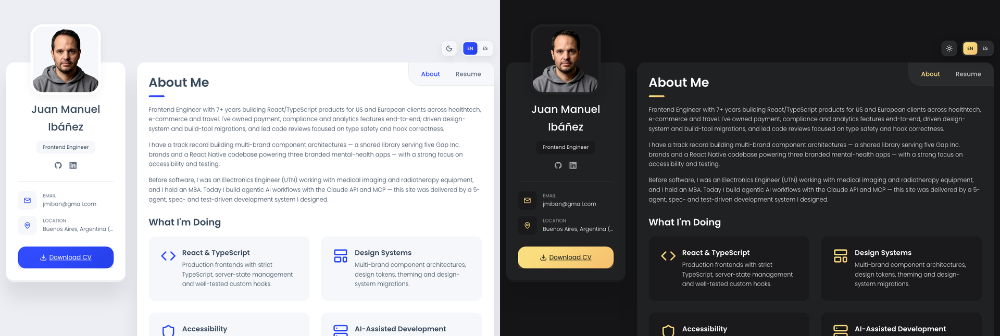
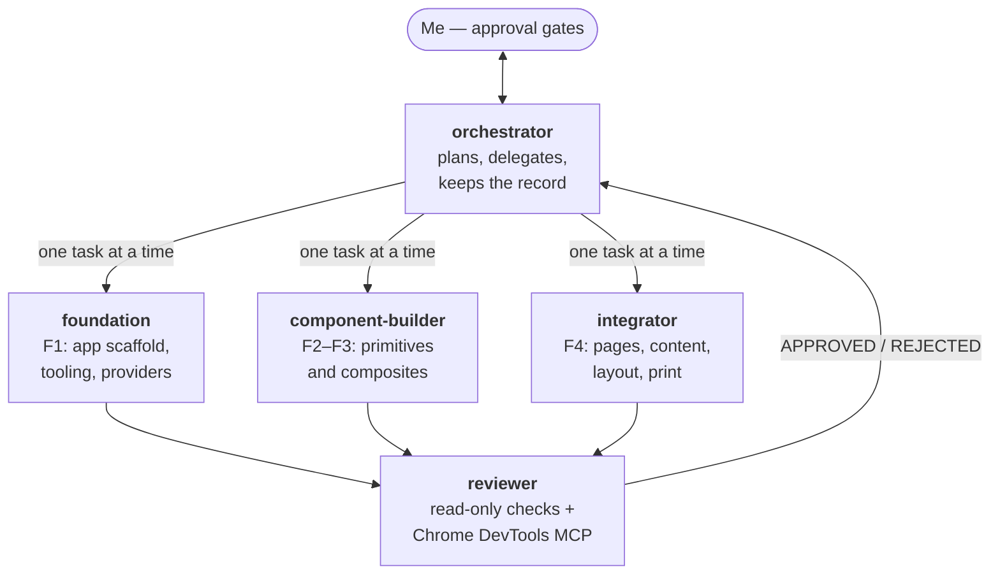

# cv-agentic

A bilingual, accessible CV site built end-to-end by a 5-agent, spec-driven AI development system — designed and directed by me, coded by the agents.

**Live demo → [jmibann.github.io/cv-agentic](https://jmibann.github.io/cv-agentic/)**



## What it is

My personal CV as a single-page React app, and a case study in governed agentic development: every component went through spec → plan → tasks → test-first implementation → independent review, with a human approval gate at each step.

The site itself:

- **English / Spanish**, switchable at runtime; all content comes from a schema-validated JSON file per locale.
- **Light / dark theme** with no flash on load (inline anti-flash script, preference persisted).
- **Accessible:** WAI-ARIA tabs, disclosure and dialog patterns, full keyboard support, visible focus; every component test ends with an automated axe-core audit.
- **Print-ready:** Ctrl+P produces a clean paper CV (About → Resume, contacts expanded, no animations).
- **Motion with restraint:** a token-based motion system that collapses to instant under `prefers-reduced-motion`.
- **Shareable:** meta description, Open Graph / Twitter cards and JSON-LD `Person` data.
- **Private by design:** no analytics, no cookies, no third-party requests at runtime.

## How it was built — the agent system

The project runs on OpenCode with five agents, each with least-privilege permissions (which files it may edit, which commands it may run):



The workflow (spec-driven development), defined as an OpenCode skill and exposed as eight `/sdd-*` commands:

1. **Spec** — every piece has a `spec.md` with EARS requirements, anatomy, API, tokens, states, responsive rules, accessibility and the exact list of expected tests.
2. **Clarify** — the reviewer hunts for ambiguities; I answer them.
3. **Plan + Tasks** — the orchestrator writes `plan.md` and `tasks.md`; I approve them per phase.
4. **Implement** — one task per delegation, strictly test-first: a `test(...)` commit in red, then a `feat(...)` commit in green.
5. **Validate** — the reviewer runs lint, typecheck, tests and build, checks the diff against the spec, and verifies the served site in a real browser through Chrome DevTools MCP.

Guardrails:

- A written **constitution** sits above everything: stack limits, spec-before-code, separation of concerns, testing rules, data protection.
- **Tests are never weakened:** no deleted or relaxed assertions, no `.skip`/`.only`, and implementation commits may not touch test files.
- **Specs are immutable** without my explicit approval; agents cannot push.
- Every rule change is logged in a numbered **decision register** (#1–#124).

The build ran in five phases — Foundation, 11 primitives, 12 composites, integration, and a final QA pass in the browser and on paper — followed by maintenance changes (deploy, CI quality gates, motion, SEO, projects section).

Claude Code acted as an independent second reviewer (audits, gate reviews) and carried out a few maintenance changes.

Details: [docs/agent-system.md](docs/agent-system.md) · [.opencode/](.opencode/) · [specs/](specs/)

## My role

I designed and directed the system; the agents wrote the production code and tests. Specifically, I:

- Designed the agent architecture, each agent's permissions, the SDD skill and the gate model.
- Wrote the constitution.
- Reviewed and approved every spec, plan, task list and phase gate.
- Made the design and product decisions recorded in the decision register.
- Ran the final paper QA (real Ctrl+P checks) and approved the browser QA.
- Wrote the CV content.

The visual design starts from an existing template, [vCard – Resume / CV / Portfolio](https://themeforest.net/item/vcard-resume-cv-portfolio-wordpress-theme/55392763) (ThemeForest); an agent analysed it and derived the visual language, tokens and specs, which I then reviewed and approved.

What I'd take from it into a team: specs with testable requirements make AI output reviewable, and strict permissions plus test-first commits are what keep agents from quietly lowering the bar.

## Tech stack

| Area | Choices |
|---|---|
| UI | React 19, TypeScript ~6.0 (`strict`, `noUncheckedIndexedAccess`, `verbatimModuleSyntax`) |
| Build | Vite 8, ESLint 10 + typescript-eslint (0 warnings) |
| Styling | CSS Modules + design tokens (`tokens/tokens.css`), Poppins (bundled), lucide-react, simple-icons |
| Content | JSON Schema → generated TypeScript types + ajv validator, run in `prebuild` |
| Testing | Vitest 5, React Testing Library, user-event, jsdom, axe-core — 488 tests in 42 files |
| CI / CD | GitHub Actions: lint → test → build → GitHub Pages (nothing ships if a gate fails) |
| Runtime | Node 26 LTS (`.nvmrc`) |

## Engineering highlights

- **Schema as the single source of truth.** `data/cv.schema.json` generates the TypeScript types and a standalone validator; the build fails if content drifts. A parity test keeps both locales structurally identical.
- **Deliberately small.** No router, no global state library, no backend: two React contexts (theme, locale) and a hash-synced tab hook cover everything. Every dependency needs approval.
- **Accessibility is tested, not assumed.** Queries by role and accessible name; axe-core in every component test; reviewer checks in a real browser.
- **Native platform first.** Native `<dialog>` for testimonials, CSS `grid-template-rows` for the disclosure animation, `@starting-style` for dialog entry.

## Getting started

```bash
nvm use            # Node 26 (.nvmrc)
npm ci
npm run dev        # http://localhost:5173
```

| Command | What it does |
|---|---|
| `npm test` | Run the full test suite |
| `npm run lint` / `npm run typecheck` | ESLint (0 warnings) / `tsc --noEmit` |
| `npm run validate:content` | Validate `src/content/cv.{en,es}.json` against the schema |
| `npm run build` | Generate types and validator, validate content, type-check and build to `dist/` |

**Edit the CV content:** change `src/content/cv.en.json` and `src/content/cv.es.json` (same ids, same order), then run `npm run validate:content && npm test`.

## Project structure

```
cv-agentic/
├─ src/            app: components, pages, providers, hooks, content (cv.en/es.json), i18n
├─ data/           CV JSON Schema (source of truth), generated types and validator, examples
├─ tokens/         design tokens (tokens.css)
├─ foundations/    typography, layout, motion, theming, i18n rules
├─ specs/          one spec/plan/tasks set per component, hook and page
├─ docs/           constitution, design kit, agent system, status log, QA report
├─ .opencode/      the 5 agents, the sdd skill and the /sdd-* commands
└─ .github/        deploy workflow with quality gates
```

## Documentation

Internal process documentation is written in English. Start here:

- [docs/STATUS.md](docs/STATUS.md) — project status and full build log
- [docs/constitution.md](docs/constitution.md) — non-negotiable rules
- [docs/agent-system.md](docs/agent-system.md) — agents, permissions and commands
- [docs/DESIGN.md](docs/DESIGN.md) — visual language and hard rules
- [docs/qa-report.md](docs/qa-report.md) — final QA report with evidence
- [specs/README.md](specs/README.md) — spec index and build order

---

Built by Juan Manuel Ibáñez · Frontend Engineer
